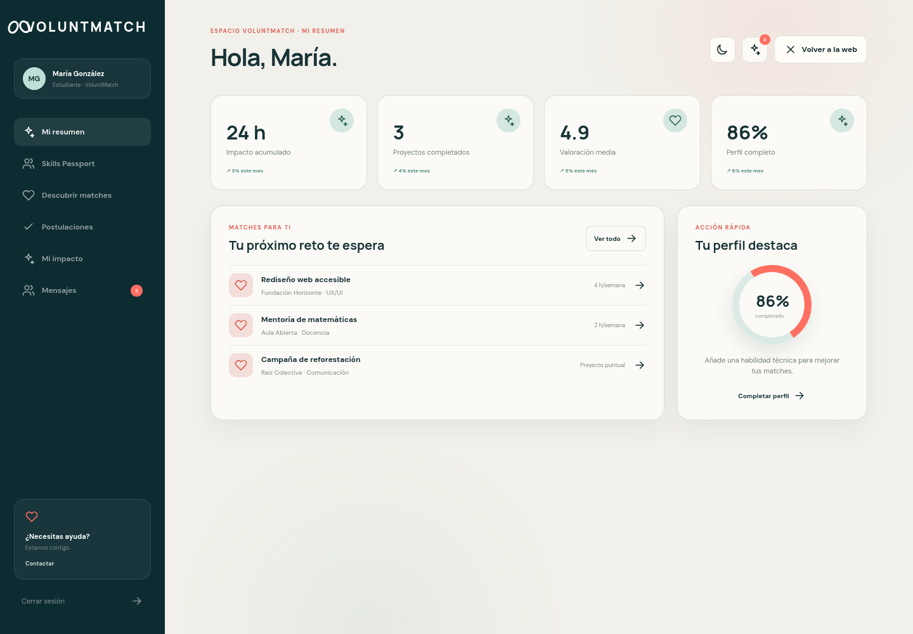
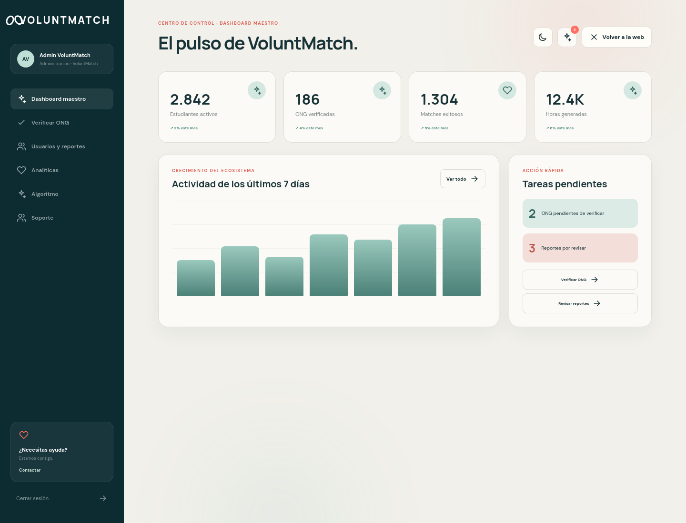

# VoluntMatch

Plataforma web que conecta estudiantes (voluntarios) con organizaciones sociales que necesitan talento para sus proyectos. La idea central: una persona quiere aportar su vocacion y una ONG busca esa vocacion para su causa. VoluntMatch hace el match entre ambos y acompana la relacion hasta el cierre del proyecto.

El proyecto esta construido sobre Laravel (aplicacion monolitica con Blade como capa de frontend). No es una SPA separada: cada pagina es una vista Blade servida por rutas web, y la interactividad (navegacion por pestanas de los paneles, kanban, chats, toasts, tema oscuro) vive en JavaScript vanilla sin build.


## Capturas

### Panel del voluntario



### Panel de la organizacion


### Panel del administrador



## Stack

- Laravel 11 (PHP >= 8.2) con Blade templates.
- SQLite por defecto (listo para usar) o MySQL, configurable en `.env`.
- CSS y JavaScript planos servidos directamente desde `public/css/app.css` y `public/js/`
  (dividido en modulos por responsabilidad en `js/site/` y `js/dashboard/`, sin build: se
  cargan en orden con `defer`).
  No hay Vite, Tailwind ni `npm`: el proyecto corre solo con PHP y Laravel.
- Autenticacion con el sistema de sesiones nativo de Laravel (regeneracion de sesion al entrar,
  limitador de intentos en el login y middleware de roles).

## Estructura del proyecto

```
voluntmatch/
├── app/
│   ├── Http/
│   │   ├── Controllers/
│   │   │   ├── AuthController.php        # registro (rol fijado por ruta), login y logout
│   │   │   ├── DashboardController.php   # paneles de organizacion y administrador
│   │   │   ├── OportunidadController.php # listado y fichas de oportunidades
│   │   │   ├── PostulacionController.php # POST /postular: persiste la postulacion del voluntario
│   │   │   └── PerfilController.php      # actualizacion de perfil y skills del voluntario
│   │   └── Middleware/
│   │       └── EnsureRole.php            # middleware 'role:admin', 'role:organizacion', etc.
│   ├── Models/
│   │   ├── User.php                      # usuario con columna role: voluntario | organizacion | admin
│   │   ├── Organizacion.php              # tabla `organizaciones`
│   │   ├── Oportunidad.php               # tabla `oportunidades`
│   │   └── Postulacion.php               # tabla `postulaciones` (una por voluntario y oportunidad)
│   ├── Providers/AppServiceProvider.php  # limitador de intentos del login
│   ├── Support/
│   │   ├── Peru.php                      # catalogos de Peru y validacion del RUC (modulo 11)
│   │   ├── OportunidadesDemo.php         # catalogo demo de oportunidades (sembrado y respaldo)
│   │   ├── ChatDemo.php                  # conversaciones de demostracion del panel
│   │   └── PerfilVoluntario.php          # datos de demostracion del perfil
│   └── View/Components/Icon.php          # componente <x-icon name="..." /> (iconos SVG inline)
├── database/
│   ├── migrations/                       # users, organizaciones, oportunidades, postulaciones,
│   │                                     # reportes, tickets, anuncios, audit_logs y configuraciones
│   ├── factories/                        # UserFactory, OrganizacionFactory, OportunidadFactory
│   └── seeders/
│       ├── DatabaseSeeder.php
│       ├── AdminSeeder.php               # crea el admin con ADMIN_EMAIL / ADMIN_PASSWORD del .env
│       ├── OportunidadSeeder.php         # siembra el catalogo demo en la tabla real `oportunidades`
│       └── AdminDemoSeeder.php           # fichas de ONG, postulaciones, reportes, tickets y anuncios demo
├── lang/es/                              # mensajes de validacion en espanol
├── public/
│   ├── css/app.css                       # todo el estilo del sitio y de los dashboards (CSS plano)
│   └── js/
│       ├── site/                          # tema, menu movil, reveal, cursor, hero, toasts,
│       │                                  # formularios por pasos y ventana de registro de ONG
│       └── dashboard/                     # paneles: navegacion, modal de proyecto, voluntario,
│                                          # chat, talento, admin, proyectos ONG, inbox y metricas
├── resources/views/
│   ├── layouts/base.blade.php            # plantilla base (head, tema claro/oscuro, scripts)
│   ├── layouts/admin.blade.php           # shell del panel admin (sidebar, buscador, contadores)
│   ├── partials/                         # header, footer, formulario-ong y registro-ong-modal
│   ├── components/icon.blade.php         # markup del componente de iconos
│   ├── index.blade.php                   # landing publica
│   ├── oportunidades.blade.php           # listado publico de oportunidades
│   ├── detalle-oportunidad.blade.php     # ficha de una oportunidad
│   ├── contacto.blade.php                # formulario de contacto publico
│   ├── pages/privacidad.blade.php        # politica de privacidad (Ley 29733)
│   ├── modules/auth/                     # login, registro-voluntario, registro-organizacion
│   ├── dashboard/                        # paneles privados: voluntario y organizacion
│   └── admin/                            # modulos del panel admin: dashboard, usuarios,
│                                         # organizaciones, oportunidades, reportes, tickets,
│                                         # anuncios, analiticas, configuracion, busqueda y auditoria
├── routes/web.php                        # todas las rutas de la aplicacion
├── tests/                                # PHPUnit: registro, roles, throttle, RUC, slug y postulaciones
└── composer.json
```

## Roles y como fluye la sesion

La tabla `users` tiene una columna `role` con tres valores:

- `voluntario` (estudiante: se asigna al registrarse desde `/registro-voluntario`)
- `organizacion` (ONG: se asigna al registrarse desde `/registro-organizacion`)
- `admin` (cuenta creada solo por el seeder `AdminSeeder`, no se registra desde la web)

Tras iniciar sesion, la ruta `/home` despacha segun el rol: cada rol cae en su propio panel privado. Los paneles privilegiados estan protegidos con el middleware de rol en `routes/web.php` (`role:organizacion` y `role:admin`); cualquier usuario con otro rol recibe un 403.

La cuenta administradora **no** existe de fabrica y sus credenciales nunca viven en el codigo: se crea con el seeder `AdminSeeder` leyendo `ADMIN_EMAIL` y `ADMIN_PASSWORD` desde tu `.env` (ver "Como correr el proyecto"). No uses la contrasenia de demo en ningun despliegue real ni la reutilices en otro sitio.

## Seguridad

- **Roles en el servidor**: cada formulario de registro envia a su propia ruta (`POST /registro-voluntario` y `POST /registro-organizacion`) y el rol lo fija el controlador; cualquier campo `role` del formulario se ignora.
- **Middleware de acceso**: `role:organizacion` y `role:admin` protegen los paneles en `routes/web.php`; `EnsureNotBlocked` expulsa a las cuentas suspendidas en la siguiente peticion.
- **Auditoria**: cada accion del panel (`suspender`, `verificar`, `destacar`, `resolver`, `responder`, `publicar`, etc.) se registra en `audit_logs` con administrador, entidad, detalle e IP.
- **Fichas no enumerables**: `/detalle-oportunidad/{slug}` resuelve por slug mediante route model binding; los ids secuenciales ya no son URLs validas.
- **Login con limite de intentos**: maximo 5 intentos por minuto por correo + IP (RateLimiter `login`); la sesion se regenera al autenticar y se invalida al salir.
- **RUC verificado**: ademas del formato (11 digitos, prefijo 10/15/17/20), se valida el digito verificador con el algoritmo modulo 11 de SUNAT (`Peru::rucValido`).
- **Datos personales**: se trata de datos regulados por la Ley 29733 del Peru. Existe una [politica de privacidad](/politica-privacidad) enlazada desde el registro y el footer, con consentimiento explicito via checkbox. La exportacion de registros con datos personales esta reservada a la administracion.
- **Credenciales fuera del codigo**: el admin se crea por seeder desde variables de entorno; nunca con una contrasenia fija en el repositorio.

## Datos de registro (Peru)

Cada formulario tiene su propia ruta y el rol lo fija el controlador. Los catalogos de opciones viven en `app/Support/Peru.php` (regiones, ciclos, disponibilidad, causas, tipos de organizacion, sectores y universidades).

- Estudiante: nombre completo, DNI (8 digitos, unico), celular peruano (9 digitos que empieza con 9), correo, region, ciudad/distrito, universidad o instituto, carrera, ciclo/grado, disponibilidad semanal y causas de interes (hasta 6).
- ONG: el registro pide solo lo esencial en dos pasos: nombre, RUC (11 digitos, prefijo 10/15/17/20, unico y con digito verificador valido), causa/sector, region, celular, correo institucional y contrasenia. Tipo de organizacion, representante legal, direccion, sitio web y mision son opcionales y viven en un apartado plegable del primer paso. La ventana de registro se abre sobre cualquier pagina publica (enlaces "Registrar ONG", hero y footer) sin salir de la pagina; `/registro-organizacion` sigue disponible como respaldo sin JavaScript.

El sitio y los paneles se adaptan a movil (desde 320 px), tableta y escritorio: rejillas fluidas, formularios de una columna en pantallas pequenas, ventana de registro tipo hoja inferior, y tablas/listas que se reorganizan en vertical.

Los mensajes de validacion estan en espanol en `lang/es/validation.php` (`APP_LOCALE=es`).

## Paginas publicas (sin sesion)

- `/` (landing, `index.blade.php`): presenta la propuesta de valor, las estadisticas, el proceso en tres pasos, causas destacadas, testimonios y FAQ.
- `/oportunidades` (`oportunidades.blade.php`): listado filtrable de oportunidades de voluntariado.
- `/detalle-oportunidad/{slug}` (`detalle-oportunidad.blade.php`): ficha completa de una oportunidad con postulacion. La ruta usa route model binding por `slug`, no el id secuencial.
- `/contacto` (`contacto.blade.php`): formulario de contacto con validacion.
- `/politica-privacidad` (`pages/privacidad.blade.php`): tratamiento de datos personales (Ley 29733).
- `/login`, `/registro-voluntario`, `/registro-organizacion` (`modules/auth/*`): acceso y altas. Cada formulario envia a su propia ruta (`POST /registro-voluntario` y `POST /registro-organizacion`) y el rol lo fija el controlador segun la ruta. El registro de ONG tambien se abre en una ventana sobre cualquier pagina publica (enlace `#registro-ong`) y conserva `/registro-organizacion` como alternativa sin JavaScript.

## Panel del voluntario

Ruta: `/home` (rol `voluntario`), vista `dashboard/voluntario.blade.php`, estilo `dashboard-student`.

Pestanas (navegacion por `data-section` / `data-panel` en `public/js/dashboard/navegacion.js`):

1. Mi resumen: metricas del voluntario, matches recomendados y completitud de perfil.
2. Skills Passport: mapa de fortalezas (grafico radar) y deslizadores para ajustar habilidades.
3. Descubrir matches: tarjetas tipo swiper de oportunidades con porcentaje de encaje; botones de descarte y postulacion.
4. Postulaciones: tabla de seguimiento con estados (en revision, aceptado, en curso).
5. Mi impacto: horas acumuladas, insignias, constancias digitales y valoracion de experiencias.
6. Mensajes: chat con organizaciones (lista de conversaciones, hilos y contexto del proyecto compartido).

## Panel de la organizacion

Ruta: `/dashboard-organizacion` (rol `organizacion`, protegido con `role:organizacion`), vista `dashboard/organizacion.blade.php`.

Pestanas:

1. Resumen: metricas de la ONG, actividad de proyectos y atajo para buscar talento.
2. Oportunidades: gestion de proyectos publicados (crear, editar estado).
3. Buscar talento: busqueda de voluntarios por habilidad.
4. Candidatos (Match Inbox): bandeja de postulaciones recibidas en vista lista o kanban, con etapas (por revisar, en entrevista, aceptado, rechazado), rechazo con mensaje automatico, proyecto al que postula cada candidato y notas internas del equipo.
5. Metricas: impacto agregado con selector de rango de fechas (ultimo mes, trimestre, ano, historico), grafico de evolucion de horas, exportacion del reporte a CSV/PDF y evaluacion de voluntarios con proyecto asociado.
6. Mensajes: chat directo con voluntarios postulados, plantillas de respuesta rapida, agendado de reunion (Google Meet o invitacion de calendario), gestor de archivos compartidos y ficha del proyecto compartido.

## Panel del administrador

Ruta principal: `/dashboard-admin` (rol `admin`, protegido con `role:admin`). Todas las
secciones viven bajo el prefijo `/admin` y comparten la plantilla
`resources/views/layouts/admin.blade.php`. Cada accion escribe en la bitacora
`audit_logs` para poder auditar quien cambio que.

| Ruta | Funcionalidad |
| --- | --- |
| `/dashboard-admin` | Dashboard maestro con metricas reales (voluntarios, ONG, oportunidades, postulaciones, matches, compromiso semanal), altas de las ultimas 8 semanas, tareas pendientes y actividad reciente. |
| `/admin/usuarios` | Busqueda por nombre/correo/DNI/RUC, filtros por rol y estado, ficha completa del usuario, suspension con motivo y reactivacion inmediata, cambio de rol, notas internas y exportacion CSV. |
| `/admin/usuarios/{id}` | Ficha 360: datos de perfil, postulaciones, reportes recibidos, notas internas y alta de incidencias. |
| `/admin/organizaciones` | Cola de verificacion de ONG con RUC, sector, mision, contacto y expediente; botones para verificar o rechazar con nota, y exportacion CSV. |
| `/admin/oportunidades` | Curaduria del catalogo: publicar, pasar a borrador, archivar, destacar, eliminar y exportar; muestra postulaciones y vistas reales. |
| `/admin/reportes` | Bandeja de moderacion: resolver o descartar reportes dejando constancia de la decision. |
| `/admin/tickets` | Mesa de soporte: registrar casos, priorizar, responder, dejar en seguimiento y cerrar. |
| `/admin/anuncios` | Comunicados para toda la comunidad, solo voluntarios o solo ONG; se muestran en los paneles de los usuarios. |
| `/admin/analiticas` | Altas mensuales, causas y habilidades mas demandadas, regiones con mas voluntarios, estado de las postulaciones y tasa de aceptacion. |
| `/admin/configuracion` | Pesos del algoritmo de matching y reglas de moderacion persistidas en `configuraciones`. |
| `/admin/actividad` | Bitacora de auditoria con filtros por accion, entidad y administrador. |
| `/admin/buscar?q=` | Busqueda global de cuentas, ONG, oportunidades, reportes y tickets. |

## Que funciona y que es prototipo

| Modulo | Estado |
| --- | --- |
| Registro de voluntario y ONG con validacion peruana (DNI, celular, RUC con digito verificador) | Funciona (persiste en BD) |
| Registro de ONG en ventana y en dos pasos, disponible desde la landing y el resto de paginas publicas | Funciona |
| Diseno adaptable a movil, tableta y escritorio (320 px en adelante) | Funciona |
| Login por rol, logout, limitador de intentos y sesiones | Funciona |
| Paneles privados con middleware de rol | Funciona |
| Perfil y skills del voluntario (`/perfil`, `/perfil/skills`) | Funciona (persiste en BD) |
| Politica de privacidad y consentimiento en el registro | Funciona (pagina estatica) |
| Catalogo y fichas de oportunidades (`/oportunidades`, `/detalle-oportunidad/{slug}`) | Funciona: lee la tabla real `oportunidades` sembrada por `OportunidadSeeder`; si la BD esta vacia usa el catalogo de respaldo en `app/Support/OportunidadesDemo.php` |
| Postularse a una oportunidad desde la ficha | Funciona (persiste en `postulaciones`, una sola postulacion por voluntario y oportunidad) |
| Match Inbox (etapas, rechazo, notas) y metricas exportables de la ONG | Prototipo: UI funcional en el navegador con persistencia en `localStorage`, sin backend |
| Chats de voluntario y ONG | Prototipo: los mensajes viven solo en la sesion de la pagina |
| Verificacion de ONG, suspension/reactivacion de cuentas, cambio de rol, reportes, tickets, anuncios y export CSV | Funciona (persiste en BD y queda en la bitacora) |
| Analiticas del admin y dashboard maestro | Funciona: se calculan sobre las tablas reales, sin datos fijos |
| Pesos del algoritmo de matching y reglas de moderacion | Funciona: se guardan en `configuraciones` (el motor de recomendacion aun no los consume) |
| Notificaciones por correo, pagos, SMS | No implementado |

## Como correr el proyecto

Requisitos: PHP >= 8.2 con las extensiones usuales de Laravel (pdo_sqlite o pdo_mysql) y Composer. No se necesita Node/npm.

```bash
composer install
cp .env.example .env      # configurar la base de datos en .env (ver abajo)
php artisan key:generate
php artisan migrate       # crea las tablas
php artisan db:seed       # crea el admin, el catalogo demo y datos de moderacion/soporte
php artisan serve
```

Base de datos:

- Por defecto `.env.example` usa `DB_CONNECTION=sqlite` y funciona sin configurar nada mas.
- Para MySQL: crea una base vacia (`CREATE DATABASE voluntmatch;`) y define en `.env` las variables `DB_CONNECTION=mysql`, `DB_HOST`, `DB_PORT`, `DB_DATABASE`, `DB_USERNAME` y `DB_PASSWORD`. `APP_LOCALE=es` ya viene configurado.
- Define en `.env` las credenciales del admin antes del `db:seed`: `ADMIN_EMAIL` y `ADMIN_PASSWORD` (una contrasenia larga y unica; si la dejas vacia, el seeder genera una aleatoria y la muestra por consola una sola vez).

## Pruebas

```bash
composer install
php artisan test          # o: ./vendor/bin/phpunit
```

La suite cubre: registro por rol (incluido el intento de colar `role=admin`), registro de ONG con datos minimos y ventana publica, bolsa de errores independiente para ONG, validacion de DNI y RUC con digito verificador, acceso a los paneles por rol, limitador de intentos del login, el seeder del admin, el seeder de oportunidades, la postulacion persistente a oportunidades y el panel de administracion (suspension, roles, verificacion de ONG, curaduria, reportes, soporte, anuncios, configuracion y exportacion CSV).

## Roadmap

- Conectar el Match Inbox de la ONG y los estados de postulacion del voluntario a la tabla `postulaciones`.
- Backend para el rechazo con correo real y las metricas exportables.
- Persistencia de mensajes con eventos y notificaciones.
- Adjuntar documentos de verificacion de ONG y descargarlos desde el panel.
- Que el motor de recomendaciones consuma los pesos guardados en `configuraciones`.
- Paginacion en el catalogo publico de oportunidades.

## Contribuir

1. Haz un fork y crea una rama desde `main`.
2. Mantén el estilo del proyecto (CSS y JS planos, Blade monolitico, validaciones en espanol).
3. Añade o actualiza pruebas para lo que cambies (`php artisan test`).
4. Abre un Pull Request describiendo el cambio.

## Licencia

Distribuido bajo la [Licencia MIT](LICENSE).
