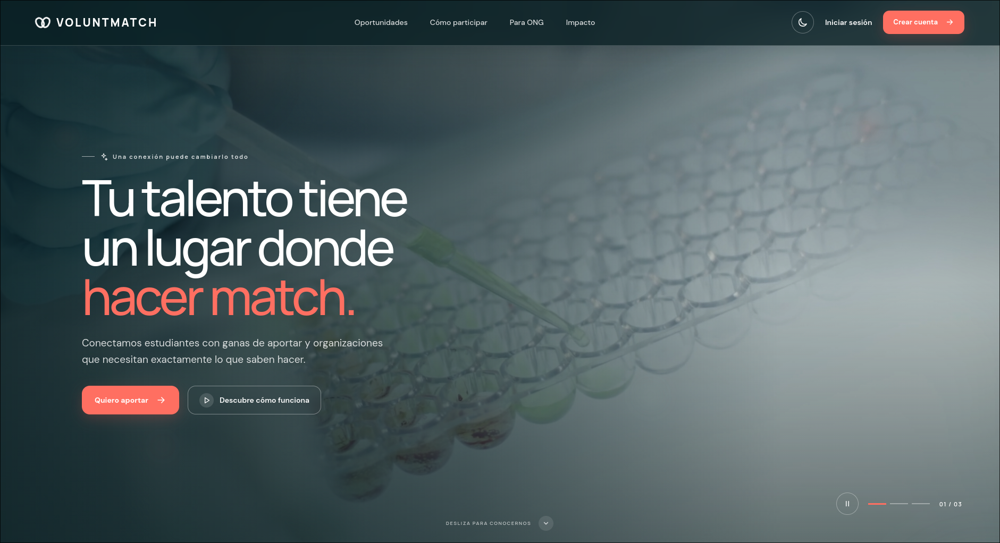
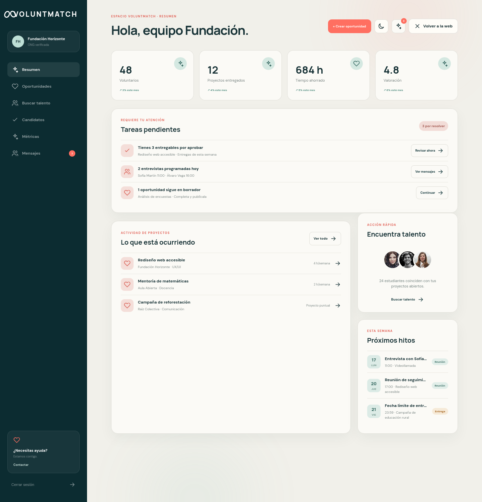

# VoluntMatch


Plataforma web que conecta estudiantes (voluntarios) con organizaciones sociales que necesitan talento para sus proyectos. La idea central: una persona quiere aportar su vocacion y una ONG busca esa vocacion para su causa. VoluntMatch hace el match entre ambos y acompana la relacion hasta el cierre del proyecto.

El proyecto esta construido sobre Laravel (aplicacion monolitica con Blade como capa de frontend). No es una SPA separada: cada pagina es una vista Blade servida por rutas web. Cada seccion de los paneles (resumen, matches, postulaciones, candidatos, metricas, etc.) tiene su propia URL y se renderiza en el servidor; la interactividad puntual (baraja de matches, kanban, chats, toasts, tema oscuro) vive en JavaScript vanilla sin build.



## Capturas

### Panel del voluntario


### Panel de la organizacion



### Panel del administrador


## Stack

- Laravel 13 (PHP >= 8.3) con Blade templates.
- SQLite por defecto (listo para usar) o MySQL, configurable en `.env`.
- CSS y JavaScript planos servidos directamente desde `public/css/app.css` y `public/js/`
  (dividido en modulos por responsabilidad en `js/site/` y `js/dashboard/`, sin build: se
  cargan en orden con `defer`).
  No hay Vite, Tailwind ni `npm`: el proyecto corre solo con PHP y Laravel.
- Autenticacion con el sistema de sesiones nativo de Laravel (regeneracion de sesion al entrar,
  limitador de intentos en el login y middleware de roles).

## Estructura del proyecto

```
voluntmatch/
├── app/
│   ├── Http/
│   │   ├── Controllers/
│   │   │   ├── Api/                        # API REST del asistente y servidor MCP
│   │   │   ├── AuthController.php        # registro (rol fijado por ruta), login y logout
│   │   │   ├── DashboardController.php   # paneles de organizacion y administrador
│   │   │   ├── OportunidadController.php # listado y fichas de oportunidades
│   │   │   ├── PostulacionController.php # POST /postular: persiste la postulacion del voluntario
│   │   │   └── PerfilController.php      # actualizacion de perfil y skills del voluntario
│   │   └── Middleware/
│   │       ├── AuthenticateApiClient.php # token Bearer, rol, scopes y cuota por cliente
│   │       └── EnsureRole.php            # middleware 'role:admin', 'role:organizacion', etc.
│   ├── Models/
│   │   ├── User.php                      # usuario con columna role: voluntario | organizacion | admin
│   │   ├── Organizacion.php              # tabla `organizaciones`
│   │   ├── Oportunidad.php               # tabla `oportunidades`
│   │   └── Postulacion.php               # tabla `postulaciones` (una por voluntario y oportunidad)
│   ├── Providers/AppServiceProvider.php  # limitador de intentos del login y del asistente
│   ├── Services/Chatbot/                 # prompts, RAG, MCP, guardrails, router, cache y observabilidad
│   ├── Services/Integrations/            # correo, calendario, CRM, mesa de ayuda y notificaciones
│   ├── Support/
│   │   ├── Peru.php                      # catalogos de Peru y validacion del RUC (modulo 11)
│   │   ├── OportunidadesDemo.php         # catalogo demo de oportunidades (sembrado y respaldo)
│   │   ├── ChatDemo.php                  # conversaciones de demostracion del panel
│   │   └── PerfilVoluntario.php          # datos de demostracion del perfil
│   └── View/Components/Icon.php          # componente <x-icon name="..." /> (iconos SVG inline)
├── database/
│   ├── migrations/                       # users, organizaciones, oportunidades, postulaciones,
│   │                                     # reportes, tickets, anuncios, audit_logs y configuraciones
│   ├── factories/                        # UserFactory, OrganizacionFactory, OportunidadFactory
│   └── seeders/
│       ├── DatabaseSeeder.php
│       ├── AdminSeeder.php               # crea el admin con ADMIN_EMAIL / ADMIN_PASSWORD del .env
│       ├── OportunidadSeeder.php         # siembra el catalogo demo (3 ONG x 10 retos) en la tabla real `oportunidades`
│       ├── ComunidadDemoSeeder.php       # 3 ONG y 14 estudiantes con postulaciones reales
│       └── AdminDemoSeeder.php           # fichas de ONG, postulaciones, reportes, tickets y anuncios demo
├── lang/es/                              # mensajes de validacion en espanol
├── public/
│   ├── css/app.css                       # todo el estilo del sitio y de los dashboards (CSS plano)
│   └── js/
│       ├── site/                          # tema, menu movil, reveal, cursor, hero, toasts,
│       │                                  # formularios por pasos y ventana de registro de ONG
│       └── dashboard/                     # interacciones: matches, modal de proyecto, chat,
│                                          # talento, admin, proyectos ONG, inbox y metricas
├── resources/views/
│   ├── layouts/base.blade.php            # plantilla base (head, tema claro/oscuro, scripts)
│   ├── layouts/admin.blade.php           # shell del panel admin (sidebar, buscador, contadores)
│   ├── partials/                         # header, footer, formulario-ong y registro-ong-modal
│   ├── components/icon.blade.php         # markup del componente de iconos
│   ├── index.blade.php                   # landing publica
│   ├── oportunidades.blade.php           # listado publico de oportunidades
│   ├── detalle-oportunidad.blade.php     # ficha de una oportunidad
│   ├── contacto.blade.php                # formulario de contacto publico
│   ├── pages/privacidad.blade.php        # politica de privacidad (Ley 29733)
│   ├── modules/auth/                     # login, registro-voluntario, registro-organizacion
│   ├── panel/                            # espacio del estudiante y panel de la ONG (una vista por seccion)
│   └── admin/                            # modulos del panel admin: dashboard, usuarios,
│                                         # organizaciones, oportunidades, reportes, tickets,
│                                         # anuncios, analiticas, configuracion, busqueda y auditoria
├── routes/web.php                        # todas las rutas de la aplicacion
├── routes/api.php                        # API v1 del asistente + servidor MCP
├── tests/                                # PHPUnit: registro, roles, throttle, RUC, slug y postulaciones
└── composer.json
```

## Roles y como fluye la sesion

La tabla `users` tiene una columna `role` con tres valores:

- `voluntario` (estudiante: se asigna al registrarse desde `/registro-voluntario`)
- `organizacion` (ONG: se asigna al registrarse desde `/registro-organizacion`)
- `admin` (cuenta creada solo por el seeder `AdminSeeder`, no se registra desde la web)

Tras iniciar sesion, la ruta `/home` despacha segun el rol: cada rol cae en su propio panel privado. Los paneles privilegiados estan protegidos con el middleware de rol en `routes/web.php` (`role:organizacion` y `role:admin`); cualquier usuario con otro rol recibe un 403.

La cuenta administradora **no** existe de fabrica y sus credenciales nunca viven en el codigo: se crea con el seeder `AdminSeeder` leyendo `ADMIN_EMAIL` y `ADMIN_PASSWORD` desde tu `.env` (ver "Como correr el proyecto"). No uses la contrasenia de demo en ningun despliegue real ni la reutilices en otro sitio.

## Seguridad

- **Roles en el servidor**: cada formulario de registro envia a su propia ruta (`POST /registro-voluntario` y `POST /registro-organizacion`) y el rol lo fija el controlador; cualquier campo `role` del formulario se ignora.
- **Middleware de acceso**: `role:organizacion` y `role:admin` protegen los paneles en `routes/web.php`; `EnsureNotBlocked` expulsa a las cuentas suspendidas en la siguiente peticion.
- **Auditoria**: cada accion del panel (`suspender`, `verificar`, `destacar`, `resolver`, `responder`, `publicar`, etc.) se registra en `audit_logs` con administrador, entidad, detalle e IP.
- **Fichas no enumerables**: `/detalle-oportunidad/{slug}` resuelve por slug mediante route model binding; los ids secuenciales ya no son URLs validas.
- **Login con limite de intentos**: maximo 5 intentos por minuto por correo + IP (RateLimiter `login`); la sesion se regenera al autenticar y se invalida al salir.
- **RUC verificado**: ademas del formato (11 digitos, prefijo 10/15/17/20), se valida el digito verificador con el algoritmo modulo 11 de SUNAT (`Peru::rucValido`).
- **Datos personales**: se trata de datos regulados por la Ley 29733 del Peru. Existe una [politica de privacidad](/politica-privacidad) enlazada desde el registro y el footer, con consentimiento explicito via checkbox. La exportacion de registros con datos personales esta reservada a la administracion.
- **Credenciales fuera del codigo**: el admin se crea por seeder desde variables de entorno; nunca con una contrasenia fija en el repositorio.

## Datos de registro (Peru)

Cada formulario tiene su propia ruta y el rol lo fija el controlador. Los catalogos de opciones viven en `app/Support/Peru.php` (regiones, ciclos, disponibilidad, causas, tipos de organizacion, sectores y universidades).

- Estudiante: nombre completo, DNI (8 digitos, unico), celular peruano (9 digitos que empieza con 9), correo, region, ciudad/distrito, universidad o instituto, carrera, ciclo/grado, disponibilidad semanal y causas de interes (hasta 6).
- ONG: el registro pide solo lo esencial en dos pasos: nombre, RUC (11 digitos, prefijo 10/15/17/20, unico y con digito verificador valido), causa/sector, region, celular, correo institucional y contrasenia. Tipo de organizacion, representante legal, direccion, sitio web y mision son opcionales y viven en un apartado plegable del primer paso. La ventana de registro se abre sobre cualquier pagina publica (enlaces "Registrar ONG", hero y footer) sin salir de la pagina; `/registro-organizacion` sigue disponible como respaldo sin JavaScript.

El sitio y los paneles se adaptan a movil (desde 320 px), tableta y escritorio: rejillas fluidas, formularios de una columna en pantallas pequenas, ventana de registro tipo hoja inferior, y tablas/listas que se reorganizan en vertical.

Los mensajes de validacion estan en espanol en `lang/es/validation.php` (`APP_LOCALE=es`).

## Paginas publicas (sin sesion)

- `/` (landing, `index.blade.php`): presenta la propuesta de valor, las estadisticas, el proceso en tres pasos, causas destacadas, testimonios y FAQ.
- `/oportunidades` (`oportunidades.blade.php`): listado filtrable de oportunidades de voluntariado.
- `/detalle-oportunidad/{slug}` (`detalle-oportunidad.blade.php`): ficha completa de una oportunidad con postulacion. La ruta usa route model binding por `slug`, no el id secuencial.
- `/contacto` (`contacto.blade.php`): formulario de contacto con validacion.
- `/politica-privacidad` (`pages/privacidad.blade.php`): tratamiento de datos personales (Ley 29733).
- `/login`, `/registro-voluntario`, `/registro-organizacion` (`modules/auth/*`): acceso y altas. Cada formulario envia a su propia ruta (`POST /registro-voluntario` y `POST /registro-organizacion`) y el rol lo fija el controlador segun la ruta. El registro de ONG tambien se abre en una ventana sobre cualquier pagina publica (enlace `#registro-ong`) y conserva `/registro-organizacion` como alternativa sin JavaScript.

## Panel del voluntario

Rutas bajo `/mi-espacio` (rol `voluntario`), cada seccion con su propia URL y vista en `resources/views/panel/voluntario/`:

| Ruta | Funcionalidad |
| --- | --- |
| `/home` o `/mi-espacio` | Mi resumen: metricas reales, matches recomendados y completitud de perfil. |
| `/mi-espacio/skills` | Skills Passport: mapa de fortalezas SVG que se actualiza en vivo con los deslizadores; cada ajuste suma al porcentaje del perfil y se guarda en `users.skills`. |
| `/mi-espacio/matches` | Baraja de oportunidades con encaje; el panel derecho explica en detalle por qué encaja cada tarjeta y cambia al deslizar. La tarjeta abre una ventana con el detalle y la acción de postularse. |
| `/mi-espacio/postulaciones` | Seguimiento real de postulaciones con estados (en revision, en entrevista, aceptado, rechazado). Cada fila abre una ventana con la línea de tiempo, la nota enviada y el acceso para completar el perfil. |
| `/mi-espacio/impacto` | Horas estimadas a partir de los proyectos aceptados, insignias y constancias. |
| `/mi-espacio/mensajes` | Chat con organizaciones (prototipo en memoria). |
| `/notificaciones` | Bandeja interna con los avisos del equipo, cambios de postulación y mensajes de las integraciones. |

## Panel de la organizacion

Rutas bajo `/panel-ong` (rol `organizacion`), una vista por seccion en `resources/views/panel/organizacion/`:

| Ruta | Funcionalidad |
| --- | --- |
| `/dashboard-organizacion` o `/panel-ong` | Resumen con metricas reales, tareas pendientes y proximos hitos. |
| `/panel-ong/oportunidades` | Oportunidades reales de la ONG, filtros por estado, buscador y formulario para publicar un reto nuevo. |
| `/panel-ong/talento` | Busqueda de estudiantes por carrera, habilidad y disponibilidad, con favoritos. |
| `/panel-ong/candidatos` | Match Inbox conectado a `postulaciones`: aceptar, rechazar, mover etapas en lista o kanban y guardar notas internas. |
| `/panel-ong/metricas` | Impacto agregado, horas, areas, exportacion CSV/PDF y evaluacion de voluntarios. |
| `/panel-ong/mensajes` | Chat con voluntarios, plantillas, agendado y archivos compartidos (prototipo en memoria). |

## Panel del administrador

Ruta principal: `/dashboard-admin` (rol `admin`, protegido con `role:admin`). Todas las
secciones viven bajo el prefijo `/admin` y comparten la plantilla
`resources/views/layouts/admin.blade.php`. Cada accion escribe en la bitacora
`audit_logs` para poder auditar quien cambio que.

| Ruta | Funcionalidad |
| --- | --- |
| `/dashboard-admin` | Dashboard maestro con metricas reales (voluntarios, ONG, oportunidades, postulaciones, matches, compromiso semanal), altas de las ultimas 8 semanas, tareas pendientes y actividad reciente. |
| `/admin/usuarios` | Busqueda por nombre/correo/DNI/RUC, filtros por rol y estado, ficha completa del usuario, suspension con motivo y reactivacion inmediata, cambio de rol, notas internas y exportacion CSV. |
| `/admin/usuarios/{id}` | Ficha 360: datos de perfil, postulaciones, reportes recibidos, notas internas y alta de incidencias. |
| `/admin/organizaciones` | Cola de verificacion de ONG con RUC, sector, mision, contacto y expediente; botones para verificar o rechazar con nota, y exportacion CSV. |
| `/admin/oportunidades` | Curaduria del catalogo: publicar, pasar a borrador, archivar, destacar, eliminar y exportar; muestra postulaciones y vistas reales. |
| `/admin/reportes` | Bandeja de moderacion: resolver o descartar reportes dejando constancia de la decision. |
| `/admin/tickets` | Mesa de soporte: registrar casos, priorizar, responder, dejar en seguimiento y cerrar. |
| `/admin/anuncios` | Comunicados para toda la comunidad, solo voluntarios o solo ONG; se muestran en los paneles de los usuarios. |
| `/admin/analiticas` | Altas mensuales, causas y habilidades mas demandadas, regiones con mas voluntarios, estado de las postulaciones y tasa de aceptacion. |
| `/admin/asistente` | Observabilidad del chatbot: consultas, latencia, cache, derivaciones, bloqueos de guardrail, uso de herramientas MCP y trazas recientes (sin texto de conversaciones). |
| `/admin/integraciones` | Estado de correo, calendario, CRM, mesa de ayuda y notificaciones; bitácora de entregas; contactos del CRM local; emisión y revocación de tokens de API/MCP (el token se muestra una sola vez). |
| `/admin/configuracion` | Pesos del algoritmo de matching y reglas de moderacion persistidas en `configuraciones`. |
| `/admin/actividad` | Bitacora de auditoria con filtros por accion, entidad y administrador. |
| `/admin/buscar?q=` | Busqueda global de cuentas, ONG, oportunidades, reportes y tickets. |

## Asistente virtual (Vera)

El sitio incluye un chatbot flotante disponible para visitantes y para las tres cuentas
(voluntario, organizacion y administracion). Responde dudas, busca oportunidades, consulta
datos de la cuenta autenticada y abre casos de soporte. Esta construido en capas para que
cada control de seguridad sea verificable por separado.

| Capa | Implementacion |
| --- | --- |
| **1. System prompt** | `resources/prompts/chatbot/system.md`, versionado en `config/chatbot.php` (`prompt.version`) e interpolado por `PromptBuilder`. Incluye jerarquia de instrucciones, limites y un canario interno que se comprueba en la salida. |
| **2. RAG** | Documentos en `chatbot_knowledge_documents` con audiencias y fragmentos BM25 en `chatbot_knowledge_chunks`. `RagRetriever` filtra por rol, cachea el corpus por version y opcionalmente combina embeddings. Corpus inicial: `ChatbotKnowledgeSeeder`. |
| **3. MCP** | `McpClient` implementa JSON-RPC/SSE (`initialize`, `tools/list`, `tools/call`). `McpManager` solo usa servidores declarados en configuracion y allowlists explicitas. Las herramientas locales (`ToolRegistry`) cubren busqueda, cuenta, ONG y soporte. |
| **4. Accesos** | El rol se toma de la sesion, nunca del mensaje. `ToolRegistry` aplica la matriz por audiencia; `ToolExecutor` vuelve a comprobarla. Las consultas privadas se limitan por `user_id` de sesion, los ids de conversacion son UUID con `owner_key` y las escrituras exigen confirmacion de un solo uso. Limite por minuto/dia y CSRF en todos los endpoints. |
| **5. Guardrails** | `GuardrailService` bloquea prompt injection, jailbreak y solicitudes ilegales; deriva autolesion; detecta PII sin bloquear; redacta logs; elimina HTML/secretos y comprueba el canario en la salida. |
| **6. Cache** | `ResponseCache` solo cachea respuestas publicas de conocimiento (nunca datos de cuenta, herramientas ni confirmaciones). La clave incluye audiencia, versiones de prompt/conocimiento y modelo. El corpus RAG tambien se cachea por version. |
| **7. Router** | `IntentRouter` clasifica saludos, FAQ, soporte, acciones y fuera de alcance con reglas deterministas; opcionalmente usa el modelo pequeno como desempate (`CHATBOT_ROUTER_LLM=true`). El router nunca autoriza herramientas. |
| **8. Observabilidad** | `chatbot_traces` guarda intencion, ruta, modelo, cache, latencia, tokens, fuentes, herramientas y flags de guardrail; `chatbot_tool_calls` registra cada invocacion (incluidas denegadas). Logs estructurados con `request_id` y panel `/admin/asistente`. El texto de la conversacion se guarda aparte para el historial y se puede desactivar con `CHATBOT_STORE_CONTENT=false`. |

### Integraciones del asistente

Además del MCP de entrada (servidores remotos), Vera puede ejecutar acciones reales sobre cinco canales. Cada una deja una fila en `integration_deliveries`, exige confirmación cuando escribe y solo acepta destinos que el servidor autoriza.

| Canal | Driver por defecto | Driver externo | Herramienta |
| --- | --- | --- | --- |
| Correo | `laravel` (usa `MAIL_*`: SMTP, Resend, Postmark…) | — | `enviar_correo` |
| Calendario | `ics` (invitación `.ics` con URL firmada temporal) | `http` (Google Calendar, CalDAV o webhook propio) | `agendar_evento` |
| CRM | `local` (tabla `crm_contacts` y espejo en el panel) | `http` (HubSpot, Pipedrive, Salesforce o webhook) | `registrar_contacto_crm` |
| Mesa de ayuda | `local` (tickets internos con `canal`) | `http` (Zendesk, Freshdesk, GLPI…), sin dejar de crear el ticket local | `crear_ticket_soporte` |
| Notificaciones | `database` (bandeja `/notificaciones`) | `webhook` (Slack, Discord, Teams…) o `both` | `notificar_candidato`, `consultar_mis_notificaciones` |

Reglas de seguridad:

- **Correo con destinatario verificado**: un voluntario solo puede escribir a su propio correo o al de una ONG a la que postuló; una ONG solo a su correo o a estudiantes que se postularon a sus retos; la administración puede escribir a cuentas registradas y a los dominios de `INTEGRATION_MAIL_ALLOWED_DOMAINS`. Hay cuota por hora y por día.
- **Notificaciones con destinatario verificado**: una ONG solo puede avisar a estudiantes que se postularon a sus oportunidades; la administración, a cualquier cuenta registrada. El aviso aparece en la bandeja interna y, si está configurado, se replica al webhook del equipo.
- **Cero URLs del usuario**: los endpoints de CRM, calendario, mesa de ayuda y webhook salen de `config/integrations.php`; el modelo nunca recibe ni decide URLs ni tokens. En producción se exige HTTPS.
- **Datos mínimos en la bitácora**: el cuerpo del correo no se guarda (solo su longitud) y los tokens nunca se persisten en claro.
- **Confirmación de un solo uso** para toda escritura, igual que en el widget web.

### API del asistente

La misma lógica del widget, sin sesión ni CSRF, para que un CRM, una app interna o un agente MCP converse con Vera. Los tokens se emiten en `/admin/integraciones` o con `php artisan api:token`.

```bash
# Emitir un token público (solo datos públicos, sin cuenta)
php artisan api:token "Portal de aliados" --role=public --scopes=assistant:chat

# Emitir un token atado a una cuenta (datos privados de esa cuenta)
php artisan api:token "Backoffice ONG" --role=organizacion \
  --email=ong@voluntmatch.test --scopes=assistant:chat --scopes=assistant:tools --scopes=assistant:confirm --days=90
```

| Método y ruta | Scope | Uso |
| --- | --- | --- |
| `POST /api/v1/assistant/messages` | `assistant:chat` | Envía `message` y `conversation_id` opcional; devuelve respuesta, fuentes, enlaces, sugerencias y confirmaciones pendientes. |
| `POST /api/v1/chat/completions` | `assistant:chat` | Interfaz compatible con OpenAI Chat Completions para enchufar a Vera en clientes que ya hablan ese protocolo (sin streaming). |
| `GET /api/v1/assistant/history` | `assistant:chat` | Historial de la conversación propia. |
| `POST /api/v1/assistant/confirm` | `assistant:confirm` | Canjea un token de confirmación con `decision=accept\|cancel`. |
| `POST /api/v1/assistant/reset` | `assistant:chat` | Cierra el hilo actual. |
| `GET /api/v1/tools` | `assistant:tools` | Catálogo de herramientas autorizadas para el rol del token. |
| `POST /api/v1/tools/{tool}` | `assistant:tools` | Invoca una herramienta con `arguments` (sin pasar por el modelo). |
| `GET\|POST /api/v1/mcp` | `mcp:use` | Servidor MCP (JSON-RPC 2.0 sobre HTTP). |
| `GET /api/v1/health` | — | Estado del servicio (sin datos). |

```bash
curl -X POST http://localhost:8000/api/v1/assistant/messages \
  -H "Authorization: Bearer vm_…" \
  -H "Content-Type: application/json" \
  -d '{"message":"Busca oportunidades de educación"}'
```

Para clientes que esperan el protocolo de OpenAI, el mismo token sirve en `POST /api/v1/chat/completions`:

```bash
curl -X POST http://localhost:8000/api/v1/chat/completions \
  -H "Authorization: Bearer vm_…" \
  -H "Content-Type: application/json" \
  -d '{"model":"vera","messages":[{"role":"user","content":"¿Cómo me registro?"}]}'
```

Cada token queda atado a un rol (`public`, `voluntario`, `organizacion`, `admin`) y, si es privado, a una cuenta concreta. El rol **no** se puede cambiar desde el cuerpo de la petición. Las respuestas de la API usan `Cache-Control: no-store` y la cuota se mide por token.

### Servidor MCP (salida)

`POST /api/v1/mcp` habla MCP Streamable HTTP (JSON-RPC 2.0) con `Authorization: Bearer vm_…` y scope `mcp:use`. Implementa `initialize`, `notifications/initialized`, `ping`, `tools/list` y `tools/call`.

- `tools/list` publica solo herramientas locales (`server: local`) autorizadas para el rol del token.
- `tools/call` devuelve `content` textual, `structuredContent` con el resultado y `isError`.
- Las escrituras responden con `requires_confirmation` y un token; el agente lo canjea llamando a `confirmar_accion`. Ese token es de un solo uso y está atado al cliente que lo generó.
- El servidor es *stateless*: no se guarda sesión; `Mcp-Session-Id` se devuelve en `initialize` y el cliente puede reenviarlo.

Ejemplo de configuración en un cliente MCP:

```json
{
  "mcpServers": {
    "voluntmatch": {
      "url": "https://voluntmatch.org/api/v1/mcp",
      "headers": { "Authorization": "Bearer vm_…" }
    }
  }
}
```

> Para conectar el asistente **hacia** servidores MCP de terceros (Gmail, HubSpot, Google Calendar, Zendesk…) se usa `CHATBOT_MCP_SERVERS` con allowlist por servidor. La API y el servidor MCP de VoluntMatch son la dirección inversa: otros agentes consumen nuestras herramientas.


### Endpoints del asistente

| Ruta | Uso |
| --- | --- |
| `POST /asistente/mensaje` | Envia un mensaje y devuelve respuesta, fuentes, enlaces, sugerencias y confirmaciones pendientes. |
| `GET /asistente/historial` | Historial de la conversacion propia (el UUID se valida contra el dueno). |
| `POST /asistente/confirmar` | Confirma o cancela una accion pendiente con token de un solo uso. |
| `POST /asistente/reiniciar` | Cierra el hilo actual y empieza uno nuevo. |

### Modos de funcionamiento

- **Local**: no necesita API externa. Responde con RAG extractivo y herramientas
  locales. Es el modo de los tests y el respaldo si falta la clave.
- **Proveedor real**: define `CHATBOT_DRIVER` y `CHATBOT_LLM_API_KEY`. Todos los
  drivers hablan el protocolo OpenAI Chat Completions y traen un preset propio.
  El modelo puede consultar las herramientas permitidas mediante function calling.
- **MCP remoto**: define `CHATBOT_MCP_ENABLED=true` y `CHATBOT_MCP_SERVERS` como JSON.
  Cada servidor debe declarar `allowed_tools`, `audiences` y, si aplica, `read_only`.
  Los servidores sin allowlist no exponen ninguna herramienta. Por defecto una
  herramienta remota se considera de escritura y exige confirmacion; marca
  `read_only: true` solo para consultas. En produccion se exige HTTPS.

| Driver | Base URL | Modelo por defecto | Embeddings |
| --- | --- | --- | --- |
| `gemini` | `generativelanguage.googleapis.com/v1beta/openai` | `gemini-2.5-flash` | Sí |
| `openai` | `api.openai.com/v1` | `gpt-4.1-mini` | Sí |
| `groq` | `api.groq.com/openai/v1` | `llama-3.3-70b-versatile` | No |
| `deepseek` | `api.deepseek.com/v1` | `deepseek-chat` | No |
| `openrouter` | `openrouter.ai/api/v1` | `google/gemini-2.5-flash` | No |
| `ollama` | `localhost:11434/v1` | `llama3.1` | Sí |

`CHATBOT_LLM_API_KEY` también acepta el nombre estándar del proveedor
(`GEMINI_API_KEY`, `OPENAI_API_KEY`, `GROQ_API_KEY`, `DEEPSEEK_API_KEY`,
`OPENROUTER_API_KEY`). El asistente envía al modelo los últimos
`CHATBOT_LLM_HISTORY_LIMIT` mensajes para mantener el hilo. Si el RAG no
encuentra contexto, el modelo puede responder igualmente de forma honesta;
desactívalo con `CHATBOT_LLM_ANSWER_WITHOUT_CONTEXT=false`.

```bash
# Verifica URL, clave, modelo y embeddings antes de publicar:
php artisan chatbot:doctor --embeddings

# Tras editar documentos de conocimiento:
php artisan chatbot:reindex
```

Las variables disponibles estan comentadas en `.env.example`. El asistente se puede apagar
por completo con `CHATBOT_ENABLED=false`.

## Que funciona y que es prototipo

| Modulo | Estado |
| --- | --- |
| Registro de voluntario y ONG con validacion peruana (DNI, celular, RUC con digito verificador) | Funciona (persiste en BD) |
| Registro de ONG en ventana y en dos pasos, disponible desde la landing y el resto de paginas publicas | Funciona |
| Diseno adaptable a movil, tableta y escritorio (320 px en adelante) | Funciona |
| Login por rol, logout, limitador de intentos y sesiones | Funciona |
| Paneles privados con middleware de rol | Funciona |
| Perfil y skills del voluntario (`/perfil`, `/perfil/skills`) | Funciona (persiste en BD); la ventana «Completar perfil» del panel permite editar todos los datos sin salir de la seccion |
| Navegacion entre modulos del panel | Funciona sin recargar en el espacio del voluntario (fetch + pushState) y con transicion de documento en los demas paneles; al refrescar se mantiene la seccion actual |
| Politica de privacidad y consentimiento en el registro | Funciona (pagina estatica) |
| Catalogo y fichas de oportunidades (`/oportunidades`, `/detalle-oportunidad/{slug}`) | Funciona: lee la tabla real `oportunidades` sembrada por `OportunidadSeeder`; si la BD esta vacia usa el catalogo de respaldo en `app/Support/OportunidadesDemo.php` |
| Postularse desde la ficha o deslizando el match a la derecha | Funciona (persiste en `postulaciones`, una sola postulacion por voluntario y oportunidad) |
| Panel del estudiante: resumen, Skills Passport, matches, postulaciones e impacto | Funciona con datos reales de la cuenta |
| Panel de la ONG: oportunidades, talento, candidatos y publicacion de retos | Funciona con datos reales de la organizacion |
| Match Inbox (aceptar, rechazar, mover etapas y notas internas) | Funciona (persiste en `postulaciones`; solo la ONG duena puede modificarlo) |
| Chats de voluntario y ONG | Prototipo: los mensajes viven solo en la sesion de la pagina |
| Asistente virtual (Vera) | Funciona: RAG con audiencias, herramientas locales/MCP, guardrails, cache, router, confirmaciones de escritura, historial y observabilidad en `/admin/asistente` |
| API del asistente y servidor MCP | Funciona: tokens con rol/scopes/cuota, conversación, historial, herramientas directas, confirmación en dos pasos y MCP JSON-RPC |
| Correo, calendario, CRM, mesa de ayuda y notificaciones | Funciona: drivers locales por defecto (CRM en BD, invitaciones `.ics` firmadas, tickets internos, bandeja `/notificaciones`) y drivers HTTP para proveedores externos |
| Verificacion de ONG, suspension/reactivacion de cuentas, cambio de rol, reportes, tickets, anuncios y export CSV | Funciona (persiste en BD y queda en la bitacora) |
| Analiticas del admin y dashboard maestro | Funciona: se calculan sobre las tablas reales, sin datos fijos |
| Pesos del algoritmo de matching y reglas de moderacion | Funciona: se guardan en `configuraciones` (el motor de recomendacion aun no los consume) |
| Pagos y SMS | No implementado |

## Como correr el proyecto

Requisitos: PHP >= 8.3 con las extensiones usuales de Laravel (pdo_sqlite o pdo_mysql) y Composer. No se necesita Node/npm.

```bash
git clone https://github.com/7omm1/voluntmatch.git
cd voluntmatch
composer install
cp .env.example .env
touch database/database.sqlite   # SQLite vacio para desarrollo
php artisan key:generate
php artisan migrate             # crea las tablas
php artisan db:seed             # admin, catalogo demo, comunidad y datos de moderacion
php artisan serve               # http://localhost:8000
```

> Si prefieres automatizarlo, `composer setup` instala dependencias, crea `.env`, genera la clave, crea el archivo SQLite y migra. Después ejecuta `php artisan db:seed`.

Base de datos:

- Por defecto `.env.example` usa `DB_CONNECTION=sqlite` y funciona sin configurar nada mas.
- Para MySQL: crea una base vacia (`CREATE DATABASE voluntmatch;`) y define en `.env` las variables `DB_CONNECTION=mysql`, `DB_HOST`, `DB_PORT`, `DB_DATABASE`, `DB_USERNAME` y `DB_PASSWORD`. `APP_LOCALE=es` ya viene configurado.
- Define en `.env` las credenciales del admin antes del `db:seed`: `ADMIN_EMAIL` y `ADMIN_PASSWORD` (una contrasenia larga y unica; si la dejas vacia, el seeder genera una aleatoria y la muestra por consola una sola vez).

### Cuentas demo

`ComunidadDemoSeeder` crea 3 ONG —cada una con 10 oportunidades distintas— y 14 estudiantes. Todas estas cuentas usan la contrasenia `password`; cambiala o no las uses fuera de desarrollo:

- ONG: `horizonte@voluntmatch.test`, `aula@voluntmatch.test`, `raiz@voluntmatch.test`
- Estudiantes: `sofia@voluntmatch.test`, `alvaro@voluntmatch.test`, `nora@voluntmatch.test`, `leo@voluntmatch.test`, ... (mismo patron de correo)

## Pruebas

```bash
composer install
php artisan test          # o: ./vendor/bin/phpunit
```

La suite cubre: registro por rol (incluido el intento de colar `role=admin`), registro de ONG con datos minimos y ventana publica, bolsa de errores independiente para ONG, validacion de DNI y RUC con digito verificador, acceso a los paneles por rol, limitador de intentos del login, los seeders de admin, oportunidades (3 ONG x 10 retos) y comunidad, la postulacion persistente (desde ficha y desde la baraja), las paginas de los paneles de estudiante y ONG, el mapa de fortalezas en vivo, las ventanas de postulacion y perfil, la gestion real del Match Inbox y el panel de administracion (suspension, roles, verificacion de ONG, curaduria, reportes, soporte, anuncios, configuracion y exportacion CSV). El asistente tiene pruebas propias de RAG, cache, prompt injection, acceso por rol, confirmacion de tickets, historial, filtrado de audiencias y observabilidad. La API y las integraciones tienen pruebas de token, scopes, aislamiento por cuenta, confirmacion en dos pasos, handshake MCP, correo con destinatarios autorizados, invitaciones `.ics`, CRM, mesa de ayuda, notificaciones y bitacora sin cuerpos sensibles.

## Roadmap

- Cola asíncrona con reintentos y backoff para entregas de integraciones.
- Edicion y archivado de oportunidades desde el panel de la ONG.
- Persistencia de mensajes con eventos y notificaciones en tiempo real.
- Adjuntar documentos de verificacion de ONG y descargarlos desde el panel.
- Que el motor de recomendaciones consuma los pesos guardados en `configuraciones`.
- Paginacion en el catalogo publico de oportunidades.

## Contribuir

1. Haz un fork y crea una rama desde `main`.
2. Mantén el estilo del proyecto (CSS y JS planos, Blade monolitico, validaciones en espanol).
3. Añade o actualiza pruebas para lo que cambies (`php artisan test`).
4. Abre un Pull Request describiendo el cambio.

## Licencia

Distribuido bajo la [Licencia MIT](LICENSE).
